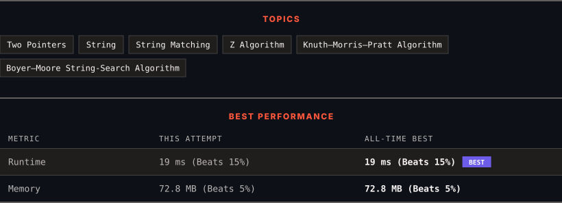

<div align="center">

# 28. Find the Index of the First Occurrence in a String

      

[](https://leetcode.com/problems/find-the-index-of-the-first-occurrence-in-a-string/)

</div>

---

<div align="center">

<picture>
  <source media="(prefers-color-scheme: dark)" srcset="panel-dark.svg">
  <source media="(prefers-color-scheme: light)" srcset="panel-light.svg">
  
</picture>

</div>

> **New personal best** — Runtime improved on this submission.

### HOW IT WENT

| | |
|:--|:--|
| **Attempts** | first try |
| **Time to solve** | 108 h 46 min |
| **Verdicts** | ✅ Accepted |

---

### NOTES

_No notes yet._

---

### SOLUTIONS (1)

| # | File | Language | Date |
|:-:|------|:--------:|:----:|
| 1 | [sol1.cpp](./sol1.cpp) | `C++` | 2026-10-11 ← **latest** |

---

### PROBLEM DESCRIPTION

Given two strings `needle` and `haystack`, return the index of the first occurrence of `needle` in `haystack`, or `-1` if `needle` is not part of `haystack`.

 

**Example 1:**

```

**Input:** haystack = "sadbutsad", needle = "sad"
**Output:** 0
**Explanation:** "sad" occurs at index 0 and 6.
The first occurrence is at index 0, so we return 0.

```

**Example 2:**

```

**Input:** haystack = "leetcode", needle = "leeto"
**Output:** -1
**Explanation:** "leeto" did not occur in "leetcode", so we return -1.

```

 

**Constraints:**

	- `1 <= haystack.length, needle.length <= 10^4`

	- `haystack` and `needle` consist of only lowercase English characters.

---

<div align="center">

<sub>Auto-synced by <strong>LeetSync</strong> · Built by <a href="https://deveshsamant.in/">Devesh Samant</a></sub>

</div>
