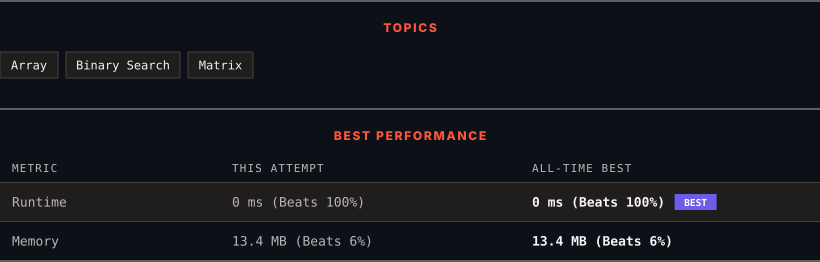

<div align="center">

# 74. Search a 2D Matrix

      

[](https://leetcode.com/problems/search-a-2d-matrix/)

</div>

---

<div align="center">

<picture>
  <source media="(prefers-color-scheme: dark)" srcset="panel-dark.svg">
  <source media="(prefers-color-scheme: light)" srcset="panel-light.svg">
  
</picture>

</div>

> **New personal best** — Runtime improved on this submission.

### HOW IT WENT

| | |
|:--|:--|
| **Attempts** | first try |
| **Time to solve** | 5 min |
| **Verdicts** | ✅ Accepted |

---

### NOTES

_No notes yet._

---

### SOLUTIONS (1)

| # | File | Language | Date |
|:-:|------|:--------:|:----:|
| 1 | [sol1.cpp](./sol1.cpp) | `C++` | 2026-10-22 ← **latest** |

---

### PROBLEM DESCRIPTION

You are given an `m x n` integer matrix `matrix` with the following two properties:

	- Each row is sorted in non-decreasing order.

	- The first integer of each row is greater than the last integer of the previous row.

Given an integer `target`, return `true` *if* `target` *is in* `matrix` *or* `false` *otherwise*.

You must write a solution in `O(log(m * n))` time complexity.

 

**Example 1:**


```

**Input:** matrix = [[1,3,5,7],[10,11,16,20],[23,30,34,60]], target = 3
**Output:** true

```

**Example 2:**


```

**Input:** matrix = [[1,3,5,7],[10,11,16,20],[23,30,34,60]], target = 13
**Output:** false

```

 

**Constraints:**

	- `m == matrix.length`

	- `n == matrix[i].length`

	- `1 <= m, n <= 100`

	- `-10^4 <= matrix[i][j], target <= 10^4`

---

<div align="center">

<sub>Auto-synced by <strong>LeetSync</strong> · Built by <a href="https://deveshsamant.in/">Devesh Samant</a></sub>

</div>
