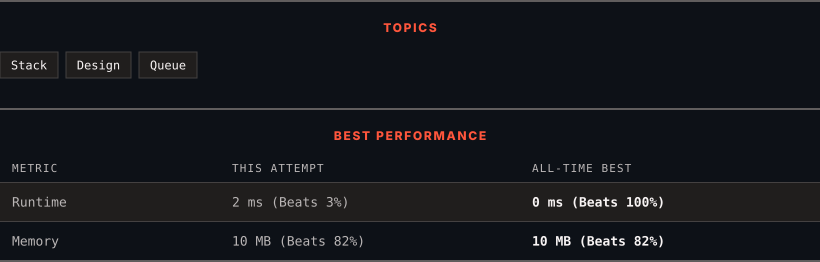

<div align="center">

# 232. Implement Queue using Stacks

      

[](https://leetcode.com/problems/implement-queue-using-stacks/)

</div>

---

<div align="center">

<picture>
  <source media="(prefers-color-scheme: dark)" srcset="panel-dark.svg">
  <source media="(prefers-color-scheme: light)" srcset="panel-light.svg">
  
</picture>

</div>

### HOW IT WENT

| | |
|:--|:--|
| **Attempts** | 2 before accepted |
| **Time to solve** | 335 h 35 min |
| **Verdicts** | ✅ Accepted → ✅ Accepted |

---

### NOTES

_No notes yet._

---

### SOLUTIONS (2)

| # | File | Language | Date |
|:-:|------|:--------:|:----:|
| 1 | [sol1.cpp](./sol1.cpp) | `C++` | 2026-10-26 |
| 2 | [sol2.cpp](./sol2.cpp) | `C++` | 2026-10-26 ← **latest** |

---

### PROBLEM DESCRIPTION

Implement a first in first out (FIFO) queue using only two stacks. The implemented queue should support all the functions of a normal queue (`push`, `peek`, `pop`, and `empty`).

Implement the `MyQueue` class:

	- `void push(int x)` Pushes element x to the back of the queue.

	- `int pop()` Removes the element from the front of the queue and returns it.

	- `int peek()` Returns the element at the front of the queue.

	- `boolean empty()` Returns `true` if the queue is empty, `false` otherwise.

**Notes:**

	- You must use **only** standard operations of a stack, which means only `push to top`, `peek/pop from top`, `size`, and `is empty` operations are valid.

	- Depending on your language, the stack may not be supported natively. You may simulate a stack using a list or deque (double-ended queue) as long as you use only a stack's standard operations.

 

**Example 1:**

```

**Input**
["MyQueue", "push", "push", "peek", "pop", "empty"]
[[], [1], [2], [], [], []]
**Output**
[null, null, null, 1, 1, false]

**Explanation**
MyQueue myQueue = new MyQueue();
myQueue.push(1); // queue is: [1]
myQueue.push(2); // queue is: [1, 2] (leftmost is front of the queue)
myQueue.peek(); // return 1
myQueue.pop(); // return 1, queue is [2]
myQueue.empty(); // return false

```

 

**Constraints:**

	- `1 <= x <= 9`

	- At most `100` calls will be made to `push`, `pop`, `peek`, and `empty`.

	- All the calls to `pop` and `peek` are valid.

 

**Follow-up:** Can you implement the queue such that each operation is **[amortized](https://en.wikipedia.org/wiki/Amortized_analysis)** `O(1)` time complexity? In other words, performing `n` operations will take overall `O(n)` time even if one of those operations may take longer.

---

<div align="center">

<sub>Auto-synced by <strong>LeetSync</strong> · Built by <a href="https://deveshsamant.in/">Devesh Samant</a></sub>

</div>
