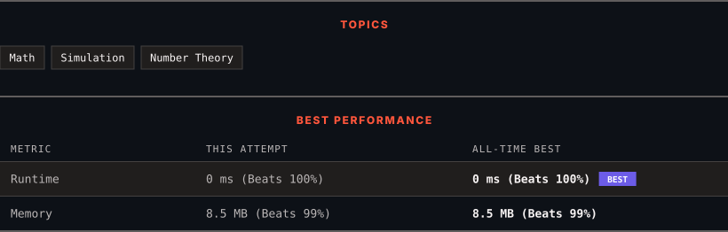

<div align="center">

# 258. Add Digits

      

[](https://leetcode.com/problems/add-digits/)

</div>

---

<div align="center">

<picture>
  <source media="(prefers-color-scheme: dark)" srcset="panel-dark.svg">
  <source media="(prefers-color-scheme: light)" srcset="panel-light.svg">
  
</picture>

</div>

> **New personal best** — Runtime improved on this submission.

### HOW IT WENT

| | |
|:--|:--|
| **Attempts** | first try |
| **Time to solve** | 6 min |
| **Verdicts** | ✅ Accepted |

---

### NOTES

_No notes yet._

---

### SOLUTIONS (1)

| # | File | Language | Date |
|:-:|------|:--------:|:----:|
| 1 | [sol1.cpp](./sol1.cpp) | `C++` | 2026-10-11 ← **latest** |

---

### PROBLEM DESCRIPTION

Given an integer `num`, repeatedly add all its digits until the result has only one digit, and return it.

 

**Example 1:**

```

**Input:** num = 38
**Output:** 2
**Explanation:** The process is
38 --> 3 + 8 --> 11
11 --> 1 + 1 --> 2 
Since 2 has only one digit, return it.

```

**Example 2:**

```

**Input:** num = 0
**Output:** 0

```

 

**Constraints:**

	- `0 <= num <= 2^31 - 1`

 

**Follow up:** Could you do it without any loop/recursion in `O(1)` runtime?

---

<div align="center">

<sub>Auto-synced by <strong>LeetSync</strong> · Built by <a href="https://deveshsamant.in/">Devesh Samant</a></sub>

</div>
