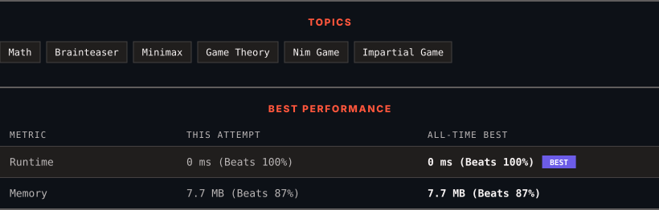

<div align="center">

# 292. Nim Game

      

[](https://leetcode.com/problems/nim-game/)

</div>

---

<div align="center">

<picture>
  <source media="(prefers-color-scheme: dark)" srcset="panel-dark.svg">
  <source media="(prefers-color-scheme: light)" srcset="panel-light.svg">
  
</picture>

</div>

> **New personal best** — Runtime improved on this submission.

### HOW IT WENT

| | |
|:--|:--|
| **Attempts** | first try |
| **Time to solve** | under a minute |
| **Verdicts** | ✅ Accepted |

---

### NOTES

_No notes yet._

---

### SOLUTIONS (1)

| # | File | Language | Date |
|:-:|------|:--------:|:----:|
| 1 | [sol1.cpp](./sol1.cpp) | `C++` | 2026-10-11 ← **latest** |

---

### PROBLEM DESCRIPTION

You are playing the following Nim Game with your friend:

	- Initially, there is a heap of stones on the table.

	- You and your friend will alternate taking turns, and **you go first**.

	- On each turn, the person whose turn it is will remove 1 to 3 stones from the heap.

	- The one who removes the last stone is the winner.

Given `n`, the number of stones in the heap, return `true`* if you can win the game assuming both you and your friend play optimally, otherwise return *`false`.

 

**Example 1:**

```

**Input:** n = 4
**Output:** false
**Explanation:** These are the possible outcomes:
1. You remove 1 stone. Your friend removes 3 stones, including the last stone. Your friend wins.
2. You remove 2 stones. Your friend removes 2 stones, including the last stone. Your friend wins.
3. You remove 3 stones. Your friend removes the last stone. Your friend wins.
In all outcomes, your friend wins.

```

**Example 2:**

```

**Input:** n = 1
**Output:** true

```

**Example 3:**

```

**Input:** n = 2
**Output:** true

```

 

**Constraints:**

	- `1 <= n <= 2^31 - 1`

---

<div align="center">

<sub>Auto-synced by <strong>LeetSync</strong> · Built by <a href="https://deveshsamant.in/">Devesh Samant</a></sub>

</div>
