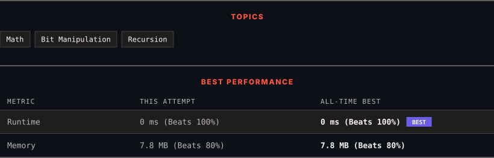

<div align="center">

# 342. Power of Four

      

[](https://leetcode.com/problems/power-of-four/)

</div>

---

<div align="center">

<picture>
  <source media="(prefers-color-scheme: dark)" srcset="panel-dark.svg">
  <source media="(prefers-color-scheme: light)" srcset="panel-light.svg">
  
</picture>

</div>

> **New personal best** — Runtime improved on this submission.

### HOW IT WENT

| | |
|:--|:--|
| **Attempts** | first try |
| **Time to solve** | under a minute |
| **Verdicts** | ✅ Accepted |

---

### NOTES

_No notes yet._

---

### SOLUTIONS (1)

| # | File | Language | Date |
|:-:|------|:--------:|:----:|
| 1 | [sol1.cpp](./sol1.cpp) | `C++` | 2026-10-11 ← **latest** |

---

### PROBLEM DESCRIPTION

Given an integer `n`, return *`true` if it is a power of four. Otherwise, return `false`*.

An integer `n` is a power of four, if there exists an integer `x` such that `n == 4^x`.

 

**Example 1:**

```
**Input:** n = 16
**Output:** true

```

**Example 2:**

```
**Input:** n = 5
**Output:** false

```

**Example 3:**

```
**Input:** n = 1
**Output:** true

```

 

**Constraints:**

	- `-2^31 <= n <= 2^31 - 1`

 

**Follow up:** Could you solve it without loops/recursion?

---

<div align="center">

<sub>Auto-synced by <strong>LeetSync</strong> · Built by <a href="https://deveshsamant.in/">Devesh Samant</a></sub>

</div>
