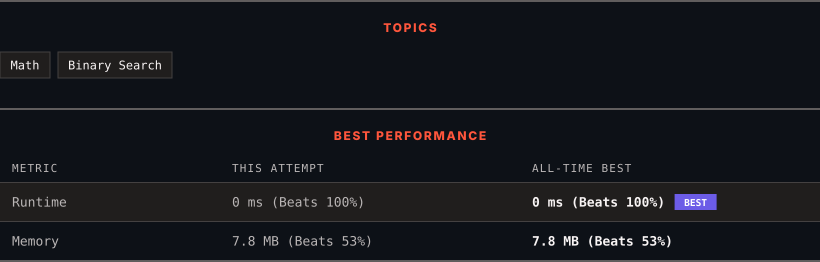

<div align="center">

# 367. Valid Perfect Square

      

[](https://leetcode.com/problems/valid-perfect-square/)

</div>

---

<div align="center">

<picture>
  <source media="(prefers-color-scheme: dark)" srcset="panel-dark.svg">
  <source media="(prefers-color-scheme: light)" srcset="panel-light.svg">
  
</picture>

</div>

> **New personal best** — Runtime improved on this submission.

### HOW IT WENT

| | |
|:--|:--|
| **Attempts** | 2 before accepted |
| **Time to solve** | 1 min |
| **Verdicts** | • Restrictions Failed → ✅ Accepted |

---

### NOTES

_No notes yet._

---

### SOLUTIONS (1)

| # | File | Language | Date |
|:-:|------|:--------:|:----:|
| 1 | [sol1.cpp](./sol1.cpp) | `C++` | 2026-10-11 ← **latest** |

---

### PROBLEM DESCRIPTION

Given a positive integer num, return `true` *if* `num` *is a perfect square or* `false` *otherwise*.

A **perfect square** is an integer that is the square of an integer. In other words, it is the product of some integer with itself.

You must not use any built-in library function, such as `sqrt`.

 

**Example 1:**

```

**Input:** num = 16
**Output:** true
**Explanation:** We return true because 4 * 4 = 16 and 4 is an integer.

```

**Example 2:**

```

**Input:** num = 14
**Output:** false
**Explanation:** We return false because 3.742 * 3.742 = 14 and 3.742 is not an integer.

```

 

**Constraints:**

	- `1 <= num <= 2^31 - 1`

---

<div align="center">

<sub>Auto-synced by <strong>LeetSync</strong> · Built by <a href="https://deveshsamant.in/">Devesh Samant</a></sub>

</div>
