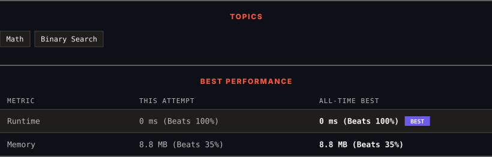

<div align="center">

# 441. Arranging Coins

      

[](https://leetcode.com/problems/arranging-coins/)

</div>

---

<div align="center">

<picture>
  <source media="(prefers-color-scheme: dark)" srcset="panel-dark.svg">
  <source media="(prefers-color-scheme: light)" srcset="panel-light.svg">
  
</picture>

</div>

> **New personal best** — Runtime improved on this submission.

### HOW IT WENT

| | |
|:--|:--|
| **Attempts** | first try |
| **Time to solve** | under a minute |
| **Verdicts** | ✅ Accepted |

---

### NOTES

_No notes yet._

---

### SOLUTIONS (1)

| # | File | Language | Date |
|:-:|------|:--------:|:----:|
| 1 | [sol1.cpp](./sol1.cpp) | `C++` | 2026-10-11 ← **latest** |

---

### PROBLEM DESCRIPTION

You have `n` coins and you want to build a staircase with these coins. The staircase consists of `k` rows where the `i^th` row has exactly `i` coins. The last row of the staircase **may be** incomplete.

Given the integer `n`, return *the number of **complete rows** of the staircase you will build*.

 

**Example 1:**


```

**Input:** n = 5
**Output:** 2
**Explanation:** Because the 3^rd row is incomplete, we return 2.

```

**Example 2:**


```

**Input:** n = 8
**Output:** 3
**Explanation:** Because the 4^th row is incomplete, we return 3.

```

 

**Constraints:**

	- `1 <= n <= 2^31 - 1`

---

<div align="center">

<sub>Auto-synced by <strong>LeetSync</strong> · Built by <a href="https://deveshsamant.in/">Devesh Samant</a></sub>

</div>
