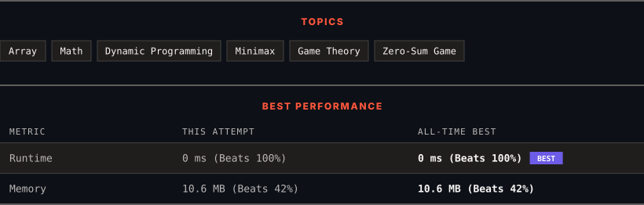

<div align="center">

# 877. Stone Game

      

[](https://leetcode.com/problems/stone-game/)

</div>

---

<div align="center">

<picture>
  <source media="(prefers-color-scheme: dark)" srcset="panel-dark.svg">
  <source media="(prefers-color-scheme: light)" srcset="panel-light.svg">
  
</picture>

</div>

> **New personal best** — Runtime improved on this submission.

### HOW IT WENT

| | |
|:--|:--|
| **Attempts** | first try |
| **Time to solve** | under a minute |
| **Verdicts** | ✅ Accepted |

---

### NOTES

_No notes yet._

---

### SOLUTIONS (1)

| # | File | Language | Date |
|:-:|------|:--------:|:----:|
| 1 | [sol1.cpp](./sol1.cpp) | `C++` | 2026-10-11 ← **latest** |

---

### PROBLEM DESCRIPTION

Alice and Bob play a game with piles of stones. There are an **even** number of piles arranged in a row, and each pile has a **positive** integer number of stones `piles[i]`.

The objective of the game is to end with the most stones. The **total** number of stones across all the piles is **odd**, so there are no ties.

Alice and Bob take turns, with **Alice starting first**. Each turn, a player takes the entire pile of stones either from the **beginning** or from the **end** of the row. This continues until there are no more piles left, at which point the person with the **most stones wins**.

Assuming Alice and Bob play optimally, return `true`* if Alice wins the game, or *`false`* if Bob wins*.

 

**Example 1:**

```

**Input:** piles = [5,3,4,5]
**Output:** true
**Explanation:** 
Alice starts first, and can only take the first 5 or the last 5.
Say she takes the first 5, so that the row becomes [3, 4, 5].
If Bob takes 3, then the board is [4, 5], and Alice takes 5 to win with 10 points.
If Bob takes the last 5, then the board is [3, 4], and Alice takes 4 to win with 9 points.
This demonstrated that taking the first 5 was a winning move for Alice, so we return true.

```

**Example 2:**

```

**Input:** piles = [3,7,2,3]
**Output:** true

```

 

**Constraints:**

	- `2 <= piles.length <= 500`

	- `piles.length` is **even**.

	- `1 <= piles[i] <= 500`

	- `sum(piles[i])` is **odd**.

---

<div align="center">

<sub>Auto-synced by <strong>LeetSync</strong> · Built by <a href="https://deveshsamant.in/">Devesh Samant</a></sub>

</div>
