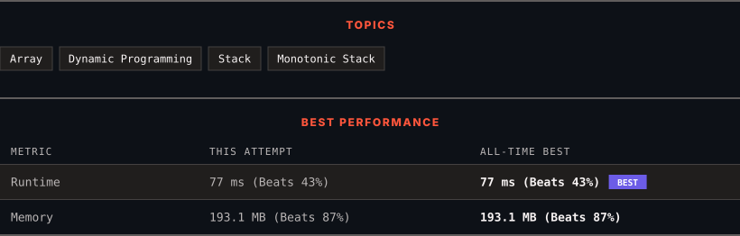

<div align="center">

# 907. Sum of Subarray Minimums

      

[](https://leetcode.com/problems/sum-of-subarray-minimums/)

</div>

---

<div align="center">

<picture>
  <source media="(prefers-color-scheme: dark)" srcset="panel-dark.svg">
  <source media="(prefers-color-scheme: light)" srcset="panel-light.svg">
  
</picture>

</div>

> **New personal best** — Runtime improved on this submission.

### HOW IT WENT

| | |
|:--|:--|
| **Attempts** | first try |
| **Time to solve** | 166 h 1 min |
| **Verdicts** | ✅ Accepted |

---

### NOTES

_No notes yet._

---

### SOLUTIONS (1)

| # | File | Language | Date |
|:-:|------|:--------:|:----:|
| 1 | [sol1.cpp](./sol1.cpp) | `C++` | 2026-10-17 ← **latest** |

---

### PROBLEM DESCRIPTION

Given an array of integers arr, find the sum of `min(b)`, where `b` ranges over every (contiguous) subarray of `arr`. Since the answer may be large, return the answer **modulo** `10^9 + 7`.

 

**Example 1:**

```

**Input:** arr = [3,1,2,4]
**Output:** 17
**Explanation:** 
Subarrays are [3], [1], [2], [4], [3,1], [1,2], [2,4], [3,1,2], [1,2,4], [3,1,2,4]. 
Minimums are 3, 1, 2, 4, 1, 1, 2, 1, 1, 1.
Sum is 17.

```

**Example 2:**

```

**Input:** arr = [11,81,94,43,3]
**Output:** 444

```

 

**Constraints:**

	- `1 <= arr.length <= 3 * 10^4`

	- `1 <= arr[i] <= 3 * 10^4`

---

<div align="center">

<sub>Auto-synced by <strong>LeetSync</strong> · Built by <a href="https://deveshsamant.in/">Devesh Samant</a></sub>

</div>
