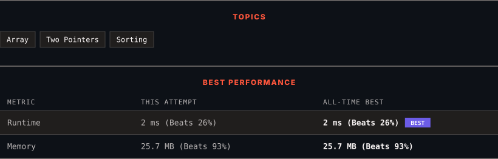

<div align="center">

# 922. Sort Array By Parity II

      

[](https://leetcode.com/problems/sort-array-by-parity-ii/)

</div>

---

<div align="center">

<picture>
  <source media="(prefers-color-scheme: dark)" srcset="panel-dark.svg">
  <source media="(prefers-color-scheme: light)" srcset="panel-light.svg">
  
</picture>

</div>

> **New personal best** — Runtime improved on this submission.

### HOW IT WENT

| | |
|:--|:--|
| **Attempts** | first try |
| **Time to solve** | 1 min |
| **Verdicts** | ✅ Accepted |

---

### NOTES

_No notes yet._

---

### SOLUTIONS (1)

| # | File | Language | Date |
|:-:|------|:--------:|:----:|
| 1 | [sol1.cpp](./sol1.cpp) | `C++` | 2026-10-19 ← **latest** |

---

### PROBLEM DESCRIPTION

Given an array of integers `nums`, half of the integers in `nums` are **odd**, and the other half are **even**.

Sort the array so that whenever `nums[i]` is odd, `i` is **odd**, and whenever `nums[i]` is even, `i` is **even**.

Return *any answer array that satisfies this condition*.

 

**Example 1:**

```

**Input:** nums = [4,2,5,7]
**Output:** [4,5,2,7]
**Explanation:** [4,7,2,5], [2,5,4,7], [2,7,4,5] would also have been accepted.

```

**Example 2:**

```

**Input:** nums = [2,3]
**Output:** [2,3]

```

 

**Constraints:**

	- `2 <= nums.length <= 2 * 10^4`

	- `nums.length` is even.

	- Half of the integers in `nums` are even.

	- `0 <= nums[i] <= 1000`

 

**Follow Up:** Could you solve it in-place?

---

<div align="center">

<sub>Auto-synced by <strong>LeetSync</strong> · Built by <a href="https://deveshsamant.in/">Devesh Samant</a></sub>

</div>
