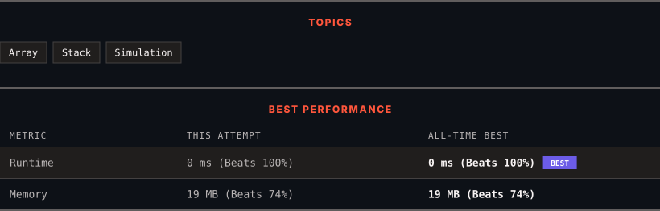

<div align="center">

# 946. Validate Stack Sequences

      

[](https://leetcode.com/problems/validate-stack-sequences/)

</div>

---

<div align="center">

<picture>
  <source media="(prefers-color-scheme: dark)" srcset="panel-dark.svg">
  <source media="(prefers-color-scheme: light)" srcset="panel-light.svg">
  
</picture>

</div>

> **New personal best** — Runtime improved on this submission.

### HOW IT WENT

| | |
|:--|:--|
| **Attempts** | first try |
| **Time to solve** | 5 min |
| **Verdicts** | ✅ Accepted |

---

### NOTES

_No notes yet._

---

### SOLUTIONS (1)

| # | File | Language | Date |
|:-:|------|:--------:|:----:|
| 1 | [sol1.cpp](./sol1.cpp) | `C++` | 2026-10-22 ← **latest** |

---

### PROBLEM DESCRIPTION

Given two integer arrays `pushed` and `popped` each with distinct values, return `true`* if this could have been the result of a sequence of push and pop operations on an initially empty stack, or *`false`* otherwise.*

 

**Example 1:**

```

**Input:** pushed = [1,2,3,4,5], popped = [4,5,3,2,1]
**Output:** true
**Explanation:** We might do the following sequence:
push(1), push(2), push(3), push(4),
pop() -> 4,
push(5),
pop() -> 5, pop() -> 3, pop() -> 2, pop() -> 1

```

**Example 2:**

```

**Input:** pushed = [1,2,3,4,5], popped = [4,3,5,1,2]
**Output:** false
**Explanation:** 1 cannot be popped before 2.

```

 

**Constraints:**

	- `1 <= pushed.length <= 1000`

	- `0 <= pushed[i] <= 1000`

	- All the elements of `pushed` are **unique**.

	- `popped.length == pushed.length`

	- `popped` is a permutation of `pushed`.

---

<div align="center">

<sub>Auto-synced by <strong>LeetSync</strong> · Built by <a href="https://deveshsamant.in/">Devesh Samant</a></sub>

</div>
