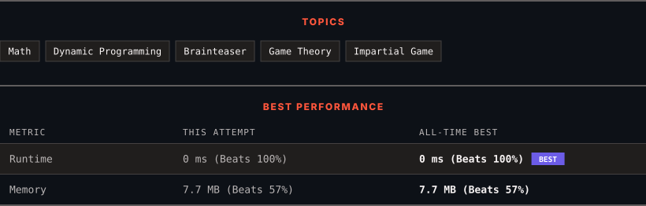

<div align="center">

# 1025. Divisor Game

      

[](https://leetcode.com/problems/divisor-game/)

</div>

---

<div align="center">

<picture>
  <source media="(prefers-color-scheme: dark)" srcset="panel-dark.svg">
  <source media="(prefers-color-scheme: light)" srcset="panel-light.svg">
  
</picture>

</div>

> **New personal best** — Runtime improved on this submission.

### HOW IT WENT

| | |
|:--|:--|
| **Attempts** | first try |
| **Time to solve** | under a minute |
| **Verdicts** | ✅ Accepted |

---

### NOTES

_No notes yet._

---

### SOLUTIONS (1)

| # | File | Language | Date |
|:-:|------|:--------:|:----:|
| 1 | [sol1.cpp](./sol1.cpp) | `C++` | 2026-10-11 ← **latest** |

---

### PROBLEM DESCRIPTION

Alice and Bob take turns playing a game, with Alice starting first.

Initially, there is a number `n` on the chalkboard. On each player's turn, that player makes a move consisting of:

	- Choosing any integer `x` with `0 < x < n` and `n % x == 0`.

	- Replacing the number `n` on the chalkboard with `n - x`.

Also, if a player cannot make a move, they lose the game.

Return `true` *if and only if Alice wins the game, assuming both players play optimally*.

 

**Example 1:**

```

**Input:** n = 2
**Output:** true
**Explanation:** Alice chooses 1, and Bob has no more moves.

```

**Example 2:**

```

**Input:** n = 3
**Output:** false
**Explanation:** Alice chooses 1, Bob chooses 1, and Alice has no more moves.

```

 

**Constraints:**

	- `1 <= n <= 1000`

---

<div align="center">

<sub>Auto-synced by <strong>LeetSync</strong> · Built by <a href="https://deveshsamant.in/">Devesh Samant</a></sub>

</div>
