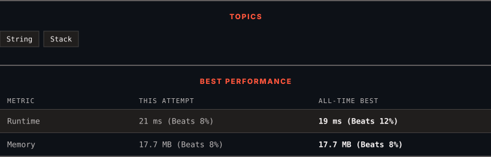

<div align="center">

# 1209. Remove All Adjacent Duplicates in String II

      

[](https://leetcode.com/problems/remove-all-adjacent-duplicates-in-string-ii/)

</div>

---

<div align="center">

<picture>
  <source media="(prefers-color-scheme: dark)" srcset="panel-dark.svg">
  <source media="(prefers-color-scheme: light)" srcset="panel-light.svg">
  
</picture>

</div>

> **New personal best** — Runtime improved on this submission.

### HOW IT WENT

| | |
|:--|:--|
| **Attempts** | first try |
| **Time to solve** | 7 min |
| **Verdicts** | ✅ Accepted |

---

### NOTES

_No notes yet._

---

### SOLUTIONS (1)

| # | File | Language | Date |
|:-:|------|:--------:|:----:|
| 1 | [sol1.cpp](./sol1.cpp) | `C++` | 2026-10-24 ← **latest** |

---

### PROBLEM DESCRIPTION

You are given a string `s` and an integer `k`, a `k` **duplicate removal** consists of choosing `k` adjacent and equal letters from `s` and removing them, causing the left and the right side of the deleted substring to concatenate together.

We repeatedly make `k` **duplicate removals** on `s` until we no longer can.

Return *the final string after all such duplicate removals have been made*. It is guaranteed that the answer is **unique**.

 

**Example 1:**

```

**Input:** s = "abcd", k = 2
**Output:** "abcd"
**Explanation: **There's nothing to delete.
```

**Example 2:**

```

**Input:** s = "deeedbbcccbdaa", k = 3
**Output:** "aa"
**Explanation: 
**First delete "eee" and "ccc", get "ddbbbdaa"
Then delete "bbb", get "dddaa"
Finally delete "ddd", get "aa"
```

**Example 3:**

```

**Input:** s = "pbbcggttciiippooaais", k = 2
**Output:** "ps"

```

 

**Constraints:**

	- `1 <= s.length <= 10^5`

	- `2 <= k <= 10^4`

	- `s` only contains lowercase English letters.

---

<div align="center">

<sub>Auto-synced by <strong>LeetSync</strong> · Built by <a href="https://deveshsamant.in/">Devesh Samant</a></sub>

</div>
