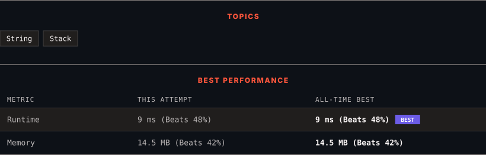

<div align="center">

# 1249. Minimum Remove to Make Valid Parentheses

      

[](https://leetcode.com/problems/minimum-remove-to-make-valid-parentheses/)

</div>

---

<div align="center">

<picture>
  <source media="(prefers-color-scheme: dark)" srcset="panel-dark.svg">
  <source media="(prefers-color-scheme: light)" srcset="panel-light.svg">
  
</picture>

</div>

> **New personal best** — Runtime improved on this submission.

### HOW IT WENT

| | |
|:--|:--|
| **Attempts** | first try |
| **Time to solve** | 1 min |
| **Verdicts** | ✅ Accepted |

---

### NOTES

_No notes yet._

---

### SOLUTIONS (1)

| # | File | Language | Date |
|:-:|------|:--------:|:----:|
| 1 | [sol1.cpp](./sol1.cpp) | `C++` | 2026-10-16 ← **latest** |

---

### PROBLEM DESCRIPTION

Given a string s of `'('` , `')'` and lowercase English characters.

Your task is to remove the minimum number of parentheses ( `'('` or `')'`, in any positions ) so that the resulting *parentheses string* is valid and return **any** valid string.

Formally, a *parentheses string* is valid if and only if:

	- It is the empty string, contains only lowercase characters, or

	- It can be written as `AB` (`A` concatenated with `B`), where `A` and `B` are valid strings, or

	- It can be written as `(A)`, where `A` is a valid string.

 

**Example 1:**

```

**Input:** s = "lee(t(c)o)de)"
**Output:** "lee(t(c)o)de"
**Explanation:** "lee(t(co)de)" , "lee(t(c)ode)" would also be accepted.

```

**Example 2:**

```

**Input:** s = "a)b(c)d"
**Output:** "ab(c)d"

```

**Example 3:**

```

**Input:** s = "))(("
**Output:** ""
**Explanation:** An empty string is also valid.

```

 

**Constraints:**

	- `1 <= s.length <= 10^5`

	- `s[i]` is either `'('` , `')'`, or lowercase English letter.

---

<div align="center">

<sub>Auto-synced by <strong>LeetSync</strong> · Built by <a href="https://deveshsamant.in/">Devesh Samant</a></sub>

</div>
