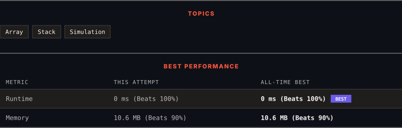

<div align="center">

# 1441. Build an Array With Stack Operations

      

[](https://leetcode.com/problems/build-an-array-with-stack-operations/)

</div>

---

<div align="center">

<picture>
  <source media="(prefers-color-scheme: dark)" srcset="panel-dark.svg">
  <source media="(prefers-color-scheme: light)" srcset="panel-light.svg">
  
</picture>

</div>

> **New personal best** — Runtime improved on this submission.

### HOW IT WENT

| | |
|:--|:--|
| **Attempts** | first try |
| **Time to solve** | under a minute |
| **Verdicts** | ✅ Accepted |

---

### NOTES

_No notes yet._

---

### SOLUTIONS (1)

| # | File | Language | Date |
|:-:|------|:--------:|:----:|
| 1 | [sol1.cpp](./sol1.cpp) | `C++` | 2026-11-18 ← **latest** |

---

### PROBLEM DESCRIPTION

You are given an integer array `target` and an integer `n`.

You have an empty stack with the two following operations:

	- **`"Push"`**: pushes an integer to the top of the stack.

	- **`"Pop"`**: removes the integer on the top of the stack.

You also have a stream of the integers in the range `[1, n]`.

Use the two stack operations to make the numbers in the stack (from the bottom to the top) equal to `target`. You should follow the following rules:

	- If the stream of the integers is not empty, pick the next integer from the stream and push it to the top of the stack.

	- If the stack is not empty, pop the integer at the top of the stack.

	- If, at any moment, the elements in the stack (from the bottom to the top) are equal to `target`, do not read new integers from the stream and do not do more operations on the stack.

Return *the stack operations needed to build *`target` following the mentioned rules. If there are multiple valid answers, return **any of them**.

 

**Example 1:**

```

**Input:** target = [1,3], n = 3
**Output:** ["Push","Push","Pop","Push"]
**Explanation:** Initially the stack s is empty. The last element is the top of the stack.
Read 1 from the stream and push it to the stack. s = [1].
Read 2 from the stream and push it to the stack. s = [1,2].
Pop the integer on the top of the stack. s = [1].
Read 3 from the stream and push it to the stack. s = [1,3].

```

**Example 2:**

```

**Input:** target = [1,2,3], n = 3
**Output:** ["Push","Push","Push"]
**Explanation:** Initially the stack s is empty. The last element is the top of the stack.
Read 1 from the stream and push it to the stack. s = [1].
Read 2 from the stream and push it to the stack. s = [1,2].
Read 3 from the stream and push it to the stack. s = [1,2,3].

```

**Example 3:**

```

**Input:** target = [1,2], n = 4
**Output:** ["Push","Push"]
**Explanation:** Initially the stack s is empty. The last element is the top of the stack.
Read 1 from the stream and push it to the stack. s = [1].
Read 2 from the stream and push it to the stack. s = [1,2].
Since the stack (from the bottom to the top) is equal to target, we stop the stack operations.
The answers that read integer 3 from the stream are not accepted.

```

 

**Constraints:**

	- `1 <= target.length <= 100`

	- `1 <= n <= 100`

	- `1 <= target[i] <= n`

	- `target` is strictly increasing.

---

<div align="center">

<sub>Auto-synced by <strong>LeetSync</strong> · Built by <a href="https://deveshsamant.in/">Devesh Samant</a></sub>

</div>
