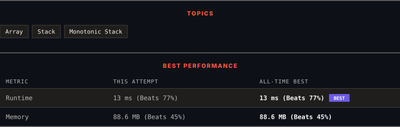

<div align="center">

# 1944. Number of Visible People in a Queue

      

[](https://leetcode.com/problems/number-of-visible-people-in-a-queue/)

</div>

---

<div align="center">

<picture>
  <source media="(prefers-color-scheme: dark)" srcset="panel-dark.svg">
  <source media="(prefers-color-scheme: light)" srcset="panel-light.svg">
  
</picture>

</div>

> **New personal best** — Runtime improved on this submission.

### HOW IT WENT

| | |
|:--|:--|
| **Attempts** | first try |
| **Time to solve** | under a minute |
| **Verdicts** | ✅ Accepted |

---

### NOTES

_No notes yet._

---

### SOLUTIONS (1)

| # | File | Language | Date |
|:-:|------|:--------:|:----:|
| 1 | [sol1.cpp](./sol1.cpp) | `C++` | 2026-11-05 ← **latest** |

---

### PROBLEM DESCRIPTION

There are `n` people standing in a queue, and they numbered from `0` to `n - 1` in **left to right** order. You are given an array `heights` of **distinct** integers where `heights[i]` represents the height of the `i^th` person.

A person can **see** another person to their right in the queue if everybody in between is **shorter** than both of them. More formally, the `i^th` person can see the `j^th` person if `i < j` and `min(heights[i], heights[j]) > max(heights[i+1], heights[i+2], ..., heights[j-1])`.

Return *an array *`answer`* of length *`n`* where *`answer[i]`* is the **number of people** the *`i^th`* person can **see** to their right in the queue*.

 

**Example 1:**


```

**Input:** heights = [10,6,8,5,11,9]
**Output:** [3,1,2,1,1,0]
**Explanation:**
Person 0 can see person 1, 2, and 4.
Person 1 can see person 2.
Person 2 can see person 3 and 4.
Person 3 can see person 4.
Person 4 can see person 5.
Person 5 can see no one since nobody is to the right of them.

```

**Example 2:**

```

**Input:** heights = [5,1,2,3,10]
**Output:** [4,1,1,1,0]

```

 

**Constraints:**

	- `n == heights.length`

	- `1 <= n <= 10^5`

	- `1 <= heights[i] <= 10^5`

	- All the values of `heights` are **unique**.

---

<div align="center">

<sub>Auto-synced by <strong>LeetSync</strong> · Built by <a href="https://deveshsamant.in/">Devesh Samant</a></sub>

</div>
