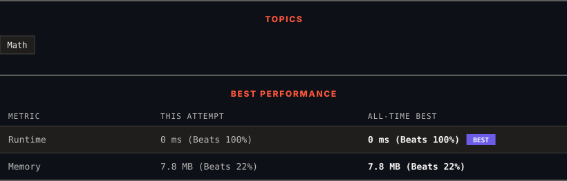

<div align="center">

# 2119. A Number After a Double Reversal

      

[](https://leetcode.com/problems/a-number-after-a-double-reversal/)

</div>

---

<div align="center">

<picture>
  <source media="(prefers-color-scheme: dark)" srcset="panel-dark.svg">
  <source media="(prefers-color-scheme: light)" srcset="panel-light.svg">
  
</picture>

</div>

> **New personal best** — Runtime improved on this submission.

### HOW IT WENT

| | |
|:--|:--|
| **Attempts** | first try |
| **Time to solve** | under a minute |
| **Verdicts** | ✅ Accepted |

---

### NOTES

_No notes yet._

---

### SOLUTIONS (1)

| # | File | Language | Date |
|:-:|------|:--------:|:----:|
| 1 | [sol1.cpp](./sol1.cpp) | `C++` | 2026-10-11 ← **latest** |

---

### PROBLEM DESCRIPTION

**Reversing** an integer means to reverse all its digits.

	- For example, reversing `2021` gives `1202`. Reversing `12300` gives `321` as the **leading zeros are not retained**.

Given an integer `num`, **reverse** `num` to get `reversed1`, **then reverse** `reversed1` to get `reversed2`. Return `true` *if* `reversed2` *equals* `num`. Otherwise return `false`.

 

**Example 1:**

```

**Input:** num = 526
**Output:** true
**Explanation:** Reverse num to get 625, then reverse 625 to get 526, which equals num.

```

**Example 2:**

```

**Input:** num = 1800
**Output:** false
**Explanation:** Reverse num to get 81, then reverse 81 to get 18, which does not equal num.

```

**Example 3:**

```

**Input:** num = 0
**Output:** true
**Explanation:** Reverse num to get 0, then reverse 0 to get 0, which equals num.

```

 

**Constraints:**

	- `0 <= num <= 10^6`

---

<div align="center">

<sub>Auto-synced by <strong>LeetSync</strong> · Built by <a href="https://deveshsamant.in/">Devesh Samant</a></sub>

</div>
