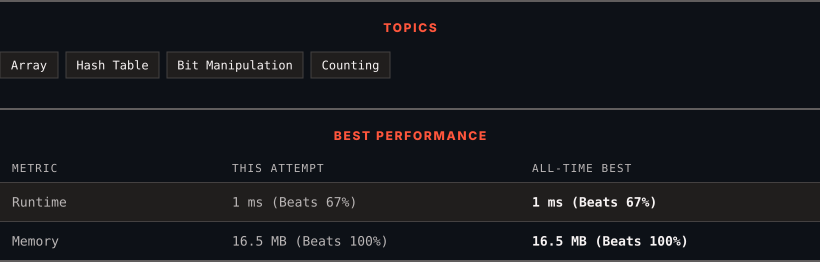

<div align="center">

# 2206. Divide Array Into Equal Pairs

      

[](https://leetcode.com/problems/divide-array-into-equal-pairs/)

</div>

---

<div align="center">

<picture>
  <source media="(prefers-color-scheme: dark)" srcset="panel-dark.svg">
  <source media="(prefers-color-scheme: light)" srcset="panel-light.svg">
  
</picture>

</div>

### HOW IT WENT

| | |
|:--|:--|
| **Attempts** | 2 before accepted |
| **Time to solve** | 25 h 43 min |
| **Verdicts** | ✅ Accepted → ✅ Accepted |

---

### NOTES

_No notes yet._

---

### SOLUTIONS (2)

| # | File | Language | Date |
|:-:|------|:--------:|:----:|
| 1 | [sol1.cpp](./sol1.cpp) | `C++` | 2026-10-21 |
| 2 | [sol2.cpp](./sol2.cpp) | `C++` | 2026-10-21 ← **latest** |

---

### PROBLEM DESCRIPTION

You are given an integer array `nums` consisting of `2 * n` integers.

You need to divide `nums` into `n` pairs such that:

	- Each element belongs to **exactly one** pair.

	- The elements present in a pair are **equal**.

Return `true` *if nums can be divided into* `n` *pairs, otherwise return* `false`.

 

**Example 1:**

```

**Input:** nums = [3,2,3,2,2,2]
**Output:** true
**Explanation:** 
There are 6 elements in nums, so they should be divided into 6 / 2 = 3 pairs.
If nums is divided into the pairs (2, 2), (3, 3), and (2, 2), it will satisfy all the conditions.

```

**Example 2:**

```

**Input:** nums = [1,2,3,4]
**Output:** false
**Explanation:** 
There is no way to divide nums into 4 / 2 = 2 pairs such that the pairs satisfy every condition.

```

 

**Constraints:**

	- `nums.length == 2 * n`

	- `1 <= n <= 500`

	- `1 <= nums[i] <= 500`

---

<div align="center">

<sub>Auto-synced by <strong>LeetSync</strong> · Built by <a href="https://deveshsamant.in/">Devesh Samant</a></sub>

</div>
