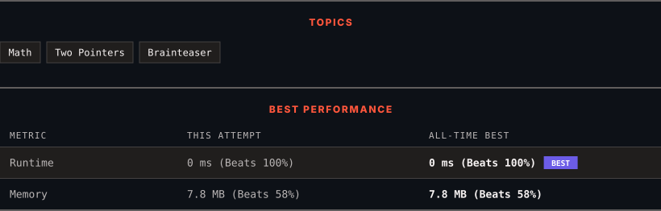

<div align="center">

# 2396. Strictly Palindromic Number

      

[](https://leetcode.com/problems/strictly-palindromic-number/)

</div>

---

<div align="center">

<picture>
  <source media="(prefers-color-scheme: dark)" srcset="panel-dark.svg">
  <source media="(prefers-color-scheme: light)" srcset="panel-light.svg">
  
</picture>

</div>

> **New personal best** — Runtime improved on this submission.

### HOW IT WENT

| | |
|:--|:--|
| **Attempts** | first try |
| **Time to solve** | under a minute |
| **Verdicts** | ✅ Accepted |

---

### NOTES

_No notes yet._

---

### SOLUTIONS (1)

| # | File | Language | Date |
|:-:|------|:--------:|:----:|
| 1 | [sol1.cpp](./sol1.cpp) | `C++` | 2026-10-11 ← **latest** |

---

### PROBLEM DESCRIPTION

An integer `n` is **strictly palindromic** if, for **every** base `b` between `2` and `n - 2` (**inclusive**), the string representation of the integer `n` in base `b` is **palindromic**.

Given an integer `n`, return `true` *if *`n`* is **strictly palindromic** and *`false`* otherwise*.

A string is **palindromic** if it reads the same forward and backward.

 

**Example 1:**

```

**Input:** n = 9
**Output:** false
**Explanation:** In base 2: 9 = 1001 (base 2), which is palindromic.
In base 3: 9 = 100 (base 3), which is not palindromic.
Therefore, 9 is not strictly palindromic so we return false.
Note that in bases 4, 5, 6, and 7, n = 9 is also not palindromic.

```

**Example 2:**

```

**Input:** n = 4
**Output:** false
**Explanation:** We only consider base 2: 4 = 100 (base 2), which is not palindromic.
Therefore, we return false.

```

 

**Constraints:**

	- `4 <= n <= 10^5`

---

<div align="center">

<sub>Auto-synced by <strong>LeetSync</strong> · Built by <a href="https://deveshsamant.in/">Devesh Samant</a></sub>

</div>
