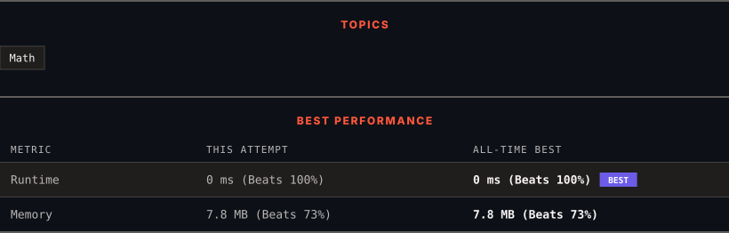

<div align="center">

# 2520. Count the Digits That Divide a Number

      

[](https://leetcode.com/problems/count-the-digits-that-divide-a-number/)

</div>

---

<div align="center">

<picture>
  <source media="(prefers-color-scheme: dark)" srcset="panel-dark.svg">
  <source media="(prefers-color-scheme: light)" srcset="panel-light.svg">
  
</picture>

</div>

> **New personal best** — Runtime improved on this submission.

### HOW IT WENT

| | |
|:--|:--|
| **Attempts** | first try |
| **Time to solve** | under a minute |
| **Verdicts** | ✅ Accepted |

---

### NOTES

_No notes yet._

---

### SOLUTIONS (1)

| # | File | Language | Date |
|:-:|------|:--------:|:----:|
| 1 | [sol1.cpp](./sol1.cpp) | `C++` | 2026-10-11 ← **latest** |

---

### PROBLEM DESCRIPTION

Given an integer `num`, return *the number of digits in `num` that divide *`num`.

An integer `val` divides `nums` if `nums % val == 0`.

 

**Example 1:**

```

**Input:** num = 7
**Output:** 1
**Explanation:** 7 divides itself, hence the answer is 1.

```

**Example 2:**

```

**Input:** num = 121
**Output:** 2
**Explanation:** 121 is divisible by 1, but not 2. Since 1 occurs twice as a digit, we return 2.

```

**Example 3:**

```

**Input:** num = 1248
**Output:** 4
**Explanation:** 1248 is divisible by all of its digits, hence the answer is 4.

```

 

**Constraints:**

	- `1 <= num <= 10^9`

	- `num` does not contain `0` as one of its digits.

---

<div align="center">

<sub>Auto-synced by <strong>LeetSync</strong> · Built by <a href="https://deveshsamant.in/">Devesh Samant</a></sub>

</div>
