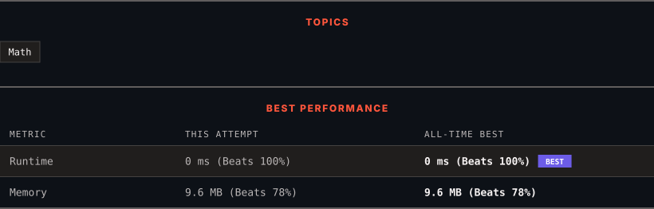

# 2769. Find the Maximum Achievable Number

      

---

<picture>
  <source media="(prefers-color-scheme: dark)" srcset="panel-dark.svg">
  <source media="(prefers-color-scheme: light)" srcset="panel-light.svg">
  
</picture>

> **New personal best** — Runtime improved on this submission.

### HOW IT WENT

| | |
|:--|:--|
| **Attempts** | first try |
| **Time to solve** | under a minute |
| **Verdicts** | ✅ Accepted |

---

### NOTES

_No notes yet._

---

### SOLUTIONS (1)

| # | File | Language | Date |
|:-:|------|:--------:|:----:|
| 1 | [sol1.cpp](./sol1.cpp) | `C++` | 2026-10-11 ← **latest** |

---

### PROBLEM DESCRIPTION

Given two integers, `num` and `t`. A **number **`x`** **is** achievable** if it can become equal to `num` after applying the following operation **at most** `t` times:

	- Increase or decrease `x` by `1`, and *simultaneously* increase or decrease `num` by `1`.

Return the **maximum **possible value of `x`.

 

**Example 1:**

**Input:** num = 4, t = 1

**Output:** 6

**Explanation:**

Apply the following operation once to make the maximum achievable number equal to `num`:

	- Decrease the maximum achievable number by 1, and increase `num` by 1.

**Example 2:**

**Input:** num = 3, t = 2

**Output:** 7

**Explanation:**

Apply the following operation twice to make the maximum achievable number equal to `num`:

	- Decrease the maximum achievable number by 1, and increase `num` by 1.

 

**Constraints:**

	- `1 <= num, t <= 50`

---

Auto-synced by <strong>LeetSync</strong> · Built by <a href="https://deveshsamant.in/">Devesh Samant</a>

