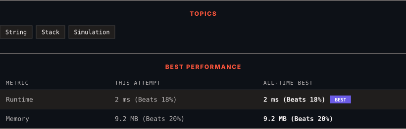

# 3174. Clear Digits

      

---

<picture>
  <source media="(prefers-color-scheme: dark)" srcset="panel-dark.svg">
  <source media="(prefers-color-scheme: light)" srcset="panel-light.svg">
  
</picture>

> **New personal best** — Runtime improved on this submission.

### HOW IT WENT

| | |
|:--|:--|
| **Attempts** | first try |
| **Time to solve** | 9 min |
| **Verdicts** | ✅ Accepted |

---

### NOTES

_No notes yet._

---

### SOLUTIONS (1)

| # | File | Language | Date |
|:-:|------|:--------:|:----:|
| 1 | [sol1.cpp](./sol1.cpp) | `C++` | 2026-10-12 ← **latest** |

---

### PROBLEM DESCRIPTION

You are given a string `s`.

Your task is to remove **all** digits by doing this operation repeatedly:

	- Delete the *first* digit and the **closest** **non-digit** character to its *left*.

Return the resulting string after removing all digits.

**Note** that the operation *cannot* be performed on a digit that does not have any non-digit character to its left.

 

**Example 1:**

**Input:** s = "abc"

**Output:** "abc"

**Explanation:**

There is no digit in the string.

**Example 2:**

**Input:** s = "cb34"

**Output:** ""

**Explanation:**

First, we apply the operation on `s[2]`, and `s` becomes `"c4"`.

Then we apply the operation on `s[1]`, and `s` becomes `""`.

 

**Constraints:**

	- `1 <= s.length <= 100`

	- `s` consists only of lowercase English letters and digits.

	- The input is generated such that it is possible to delete all digits.

---

Auto-synced by <strong>LeetSync</strong> · Built by <a href="https://deveshsamant.in/">Devesh Samant</a>

