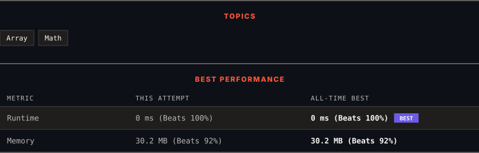

# 3875. Construct Uniform Parity Array I

      

---

<picture>
  <source media="(prefers-color-scheme: dark)" srcset="panel-dark.svg">
  <source media="(prefers-color-scheme: light)" srcset="panel-light.svg">
  
</picture>

> **New personal best** — Runtime improved on this submission.

### HOW IT WENT

| | |
|:--|:--|
| **Attempts** | first try |
| **Time to solve** | 15 min |
| **Verdicts** | ✅ Accepted |

---

### NOTES

_No notes yet._

---

### SOLUTIONS (1)

| # | File | Language | Date |
|:-:|------|:--------:|:----:|
| 1 | [sol1.cpp](./sol1.cpp) | `C++` | 2026-10-11 ← **latest** |

---

### PROBLEM DESCRIPTION

You are given an array `nums1` of `n` **distinct** integers.

You want to construct another array `nums2` of length `n` such that the elements in `nums2` are either **all odd or all even**.

For each index `i`, you must choose **exactly one** of the following (in any order):

	- `nums2[i] = nums1[i]`

	- `nums2[i] = nums1[i] - nums1[j]`, for an index `j != i`

Return `true` if it is possible to construct such an array, otherwise, return `false`.

 

**Example 1:**

**Input:** nums1 = [2,3]

**Output:** true

**Explanation:**

	- Choose `nums2[0] = nums1[0] - nums1[1] = 2 - 3 = -1`.

	- Choose `nums2[1] = nums1[1] = 3`.

	- `nums2 = [-1, 3]`, and both elements are odd. Thus, the answer is `true`​​​​​​​.

**Example 2:**

**Input:** nums1 = [4,6]

**Output:** true

**Explanation:**​​​​​​​

	- Choose `nums2[0] = nums1[0] = 4`.

	- Choose `nums2[1] = nums1[1] = 6`.

	- `nums2 = [4, 6]`, and all elements are even. Thus, the answer is `true`.

 

**Constraints:**

	- `1 <= n == nums1.length <= 100`

	- `1 <= nums1[i] <= 100`

	- `nums1` consists of distinct integers.

---

Auto-synced by <strong>LeetSync</strong> · Built by <a href="https://deveshsamant.in/">Devesh Samant</a>

